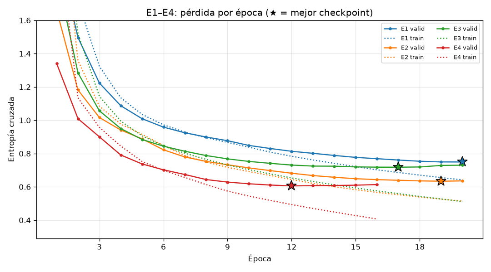
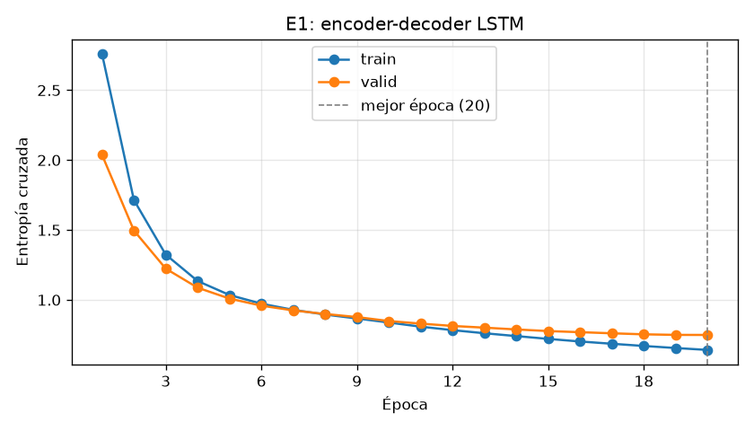
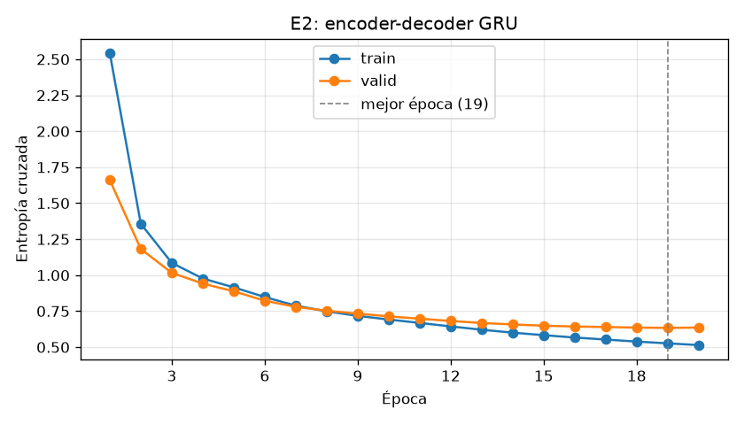
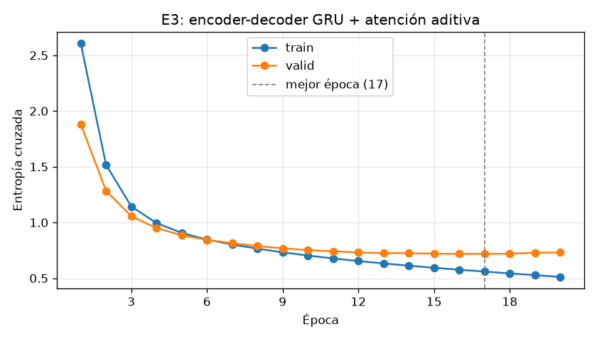
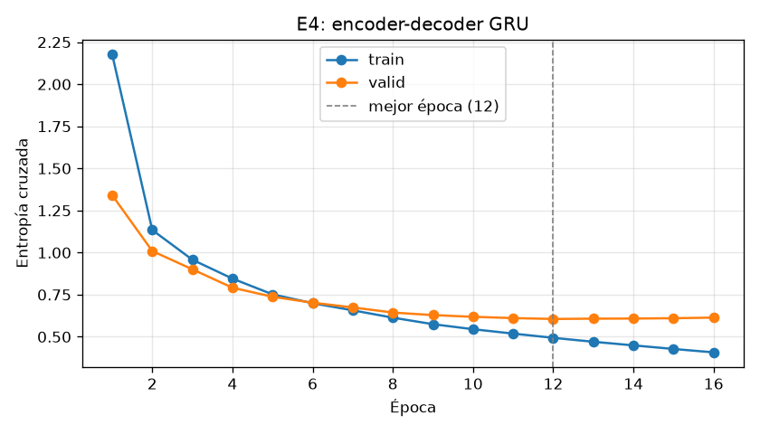
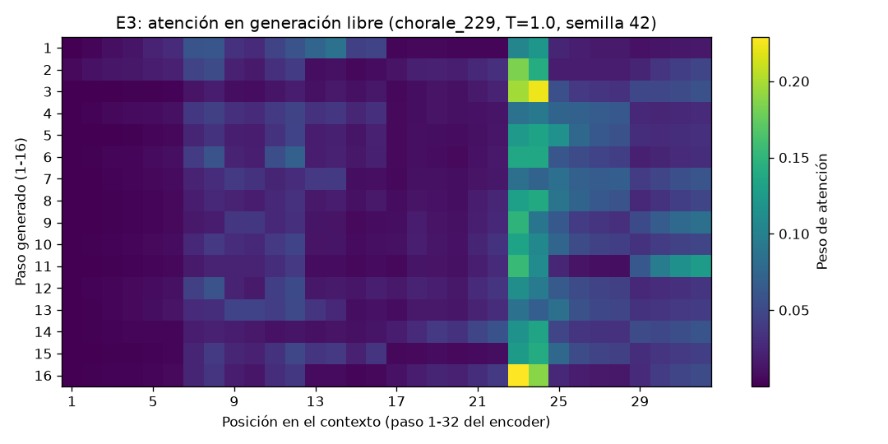
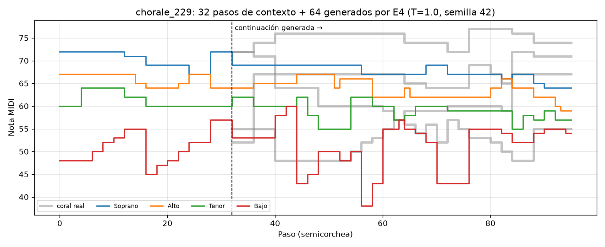
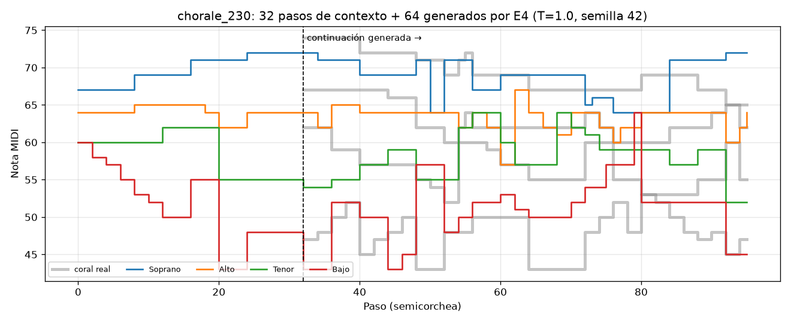

# Bach — Generación de secuencias musicales con modelos recurrentes y atención

Laboratorio de **Procesamiento de Lenguaje Natural – 2026 S02** (Universidad Sergio Arboleda) · **Equipo F**

Se entrena un encoder-decoder para continuar corales de Bach: a partir de **32 pasos** (4 voces por paso,
notas 0–127, `0` = silencio) el modelo predice los **16 pasos siguientes**. Se comparan LSTM, GRU y GRU con
atención, más un cuarto experimento; el modelo se elige por **pérdida de validación** en **MLflow** y se
publica con una **API FastAPI**.

| Componente | Enlace / estado |
|------------|-----------------|
| MLflow (experimento `nlp-bach-equipoF`) | http://3.229.168.127:5000 — acceso restringido por IP (Security Group) |
| API FastAPI | http://3.229.168.127:8000/docs — sirve `bach-chorales-equipoF` v1 (`champion`) |
| Modelo elegido | **E4** · run `042df735c704434f8e2cac7e58d922c0` |
| Evidencias musicales | [2 MIDI](outputs/generacion/) · [mapa de atención E3](docs/img/attention_E3.png) |

| Fase | Estado |
|------|--------|
| 0. Entorno (EC2 + MLflow + S3) | ✅ |
| 1. Datos y ventanas | ✅ |
| 2. Modelos E1–E3 | ✅ |
| 3. E4, selección y test | ✅ |
| 4. Generación musical (2 MIDI) | ✅ |
| 5. Registro `champion` y API | ✅ |
| 6. Informe final | ✅ este README |

---

## 1. Datos

Se usa JSB Chorales en la versión de Géron, con sus particiones originales. Cada CSV tiene las columnas
`note0, note1, note2, note3`; cada fila es una semicorchea. `python -m bach.data` descarga los datos y
ejecuta estas comprobaciones:

| Partición | Corales | Pasos por coral (mín–máx) | Silencios | Stride | Ventanas X (n,32,4) / Y (n,16,4) |
|-----------|--------:|:----:|:----:|:----:|-----:|
| train | 229 | 100–516 | 0.1–0.2 % | 8 | 5 681 |
| valid | 76 | 128–576 | 0.8 % | 16 | 982 |
| test | 77 | 128–640 | 0.4 % | 16 | 1 011 |

- Vocabulario fijo 0–127 sin recodificar. Los valores reales van de 36 a 81 (más el `0`).
- Las ventanas de 48 pasos se cortan **dentro de cada coral** y se descartan los fragmentos incompletos.
  Ninguna ventana cruza corales ni particiones, y las mismas ventanas se usan en todos los experimentos.
- El silencio `0` es una clase más: no se usa como relleno (no hace falta, las ventanas tienen longitud fija)
  y **entra en la pérdida**.

## 2. Modelos y protocolo

| ID | Arquitectura | Qué compara |
|----|--------------|-------------|
| E1 | Encoder-decoder LSTM | Referencia |
| E2 | Encoder-decoder GRU | Celda recurrente, frente a E1 |
| E3 | Encoder-decoder GRU + atención aditiva (Bahdanau) | Efecto de la atención, frente a E2 |
| E4 | E2 con **hidden 256** | Un solo hiperparámetro sobre el mejor de E1–E3 |

Decisiones comunes ([`src/bach/models.py`](src/bach/models.py)):

- **Entrada de cada paso:** una tabla de embeddings compartida (16 dims por nota). Los 4 vectores se concatenan
  en el orden de las voces, así que cada paso es un vector de 64.
- **Estado inicial del decoder:** el estado final del encoder (en LSTM se transfieren `h` y `c`).
- **E3:** en cada paso del decoder se calcula `score = vᵀ tanh(W_q h + W_k e_j)` sobre las 32 salidas del encoder;
  el contexto resultante se concatena con la entrada del decoder. Todo lo demás es igual a E2.
- **Teacher forcing** en entrenamiento y validación: las entradas del decoder son el último paso de X seguido de
  `Y[0..14]`. En generación libre, cada entrada es la muestra anterior.
- **Salida:** logits `(batch, 16, 4, 128)`. La pérdida es `CrossEntropyLoss` sobre `(batch·16·4, 128)`, sin softmax previo.
- **Exactitud por nota:** notas acertadas con argmax. **Exactitud por paso:** pasos con las 4 notas correctas.
  Ambas se acumulan sobre toda la partición y se miden en modo evaluación, sin gradientes y con teacher forcing.

Hiperparámetros base, iguales en E1–E3:
- 1 capa unidireccional, hidden 128, embedding 16;
- Adam con lr 1e-3, batch 64;
- máximo 20 épocas, con parada temprana tras 4 épocas sin bajar la pérdida de validación;
- semilla 42 reiniciada en cada run.

Equipo de cómputo: CPU Intel Core i5-11400H (6 hilos de torch), torch 2.14.1+cpu, Windows 11.

Cada run guarda el **checkpoint de menor pérdida de validación**, lo recarga al terminar y calcula las
exactitudes **con ese checkpoint**, nunca con la última época. Todo queda en MLflow:

| Tipo | Qué se guarda |
|------|---------------|
| Parámetros | arquitectura, atención, capas, hidden, embedding, lr, batch, épocas máximas, semilla, contexto, horizonte |
| Métricas | pérdidas por época; mejor época, mejor pérdida de validación y exactitudes; parámetros entrenables; tiempo |
| Artefactos | `config.json`, `history.json`, curva de pérdidas, checkpoint, `hardware.json`; en E3, el mapa de atención |

## 3. Resultados E1–E4

Métricas de **validación** del mejor checkpoint de cada run:

| Run | Arquitectura | Hidden | Parámetros entrenables | Mejor época / épocas | Val loss | Exactitud nota | Exactitud paso | Tiempo |
|-----|--------------|-------:|-----------:|:----:|:----:|:----:|:----:|----:|
| E1 | LSTM | 128 | 266 752 | 20 / 20 | 0.7494 | 0.7896 | 0.5985 | 32 s |
| E2 | GRU | 128 | 217 088 | 19 / 20 | 0.6339 | 0.8158 | 0.6382 | 54 s |
| E3 | GRU + atención | 128 | 299 136 | 17 / 20 | 0.7181 | 0.7908 | 0.6058 | 123 s |
| **E4** | **GRU** | **256** | **628 224** | **12 / 16** | **0.6057** | **0.8217** | **0.6451** | 74 s |



La línea continua es la validación y la punteada el entrenamiento; ★ marca la época del checkpoint guardado.
En las primeras épocas la pérdida de entrenamiento queda por encima de la de validación. La razón es que la de
entrenamiento es el promedio de toda la época, mientras el modelo todavía aprende, y la de validación se mide al
final de la época.

<table>
<tr><td></td><td></td></tr>
<tr><td></td><td></td></tr>
</table>

### E1 frente a E2: LSTM vs GRU

- **El GRU gana:** baja la pérdida de validación de 0.749 a 0.634 (−15 %) y sube la exactitud por paso de 0.599 a
  0.638, con un **19 % menos de parámetros** (el GRU tiene 3 compuertas por capa; el LSTM, 4 y una celda de memoria).
- **El LSTM no había convergido:** su mejor época fue la 20, la última permitida, y la curva seguía bajando. La
  comparación es justa con el protocolo común de 20 épocas, pero no muestra el techo del LSTM. Con más épocas la
  diferencia podría reducirse.
- **El GRU aprende más rápido por época:** en la época 4 ya tenía una pérdida de validación de 0.94; el LSTM
  necesitó 7 épocas para llegar a 0.92.

### E2 frente a E3: efecto de la atención

- **La atención no mejoró:** E3 termina en 0.718, frente a 0.634 de E2, y con **un 38 % más de parámetros**
  (W_q, W_k, v y una entrada al decoder 128 dimensiones más ancha).
- **E3 sobreajusta antes:** su mejor época es la 17; después la pérdida de entrenamiento sigue bajando
  (0.56 → 0.51) mientras la de validación sube (0.718 → 0.730).
- **Una posible explicación, no comprobada:** con un contexto de solo 32 pasos, el estado final del GRU ya
  resume bien el fragmento, y la atención agrega capacidad que aquí se traduce en sobreajuste más que en
  información nueva.
- **Costo:** el decoder con atención se ejecuta paso a paso y E3 tardó 2,3 veces más que E2.

### E4: por qué hidden 256 y qué mostró

E4 parte de **E2**, el mejor de E1–E3, y cambia **solo** la dimensión oculta de 128 a 256. Se entrena desde cero,
con las mismas ventanas, semilla y métricas.

- **Por qué este cambio:** E2 (el más pequeño) ganó y E3 (más grande, pero con atención) perdió. Faltaba saber si
  el problema de E3 era el tamaño o la atención. E4 separa esas dos variables: más capacidad, sin atención.
- **Qué mostró:** la pérdida de validación bajó de 0.634 a **0.606** (−4,4 %) y subieron las dos exactitudes.
  Entonces el peor resultado de E3 no se explica solo por tener más parámetros.
- **Comportamiento del entrenamiento:** E4 converge mucho antes (mejor época 12 frente a 19) y es el **único run
  que activó la parada temprana**, en la época 16. Desde la época 13 la pérdida de entrenamiento sigue bajando
  (0.49 → 0.41) y la de validación sube un poco: empieza a sobreajustar. El checkpoint guardado es el de la época 12.

### Modelo elegido: E4

**Criterio:** el que fija la guía, la menor pérdida de validación entre todos los runs comparables. E4 tiene la
menor (0.6057), además de las mejores exactitudes por nota (0.822) y por paso (0.645). La selección la hace
[`src/bach/select.py`](src/bach/select.py) leyendo los runs de MLflow.

Al interpretar la elección hay que tener en cuenta:
- **Una sola semilla:** la semilla 42 hace comparables las ejecuciones, pero con un solo entrenamiento por
  configuración no se puede afirmar que el GRU de 256 sea superior en general. La diferencia con E2 (0.028 de
  pérdida, 0.6 puntos de exactitud por nota) es pequeña y podría cambiar con otra semilla.
- **El tamaño:** E4 tiene **2,9 veces los parámetros de E2** (628 k frente a 217 k). La mejora tiene un costo en
  memoria y en tiempo de inferencia, aunque para la API en CPU sigue siendo un modelo pequeño (unos 2,5 MB).
- **La pérdida es una medida predictiva, no musical:** mide qué tan bien se predice la nota real con teacher
  forcing. No garantiza que la continuación generada libremente suene mejor; eso se analiza en la generación.

### Evaluación en test

Se evaluó **solo E4, después de elegirlo**, con su checkpoint de la época 12 (descargado del run en MLflow) y el
mismo protocolo de validación. Las métricas se registraron en su run, con la etiqueta `seleccionado=true`.
`test` no se usó para ninguna decisión de arquitectura, hiperparámetros ni época.

| Partición | Pérdida | Exactitud nota | Exactitud paso |
|-----------|:----:|:----:|:----:|
| valid | 0.6057 | 0.8217 | 0.6451 |
| **test** | **0.6256** | **0.8157** | **0.6268** |

Test queda un poco por debajo de validación (+0.02 de pérdida), lo esperado al medir sobre corales que no se
usaron para elegir el modelo.

### Mapa de atención de E3

Para el mapa se usó el mejor checkpoint de E3 (época 17), en **generación libre** (sin teacher forcing) de 16 pasos.
El contexto son los primeros 32 pasos de `chorale_229` (valid), con T = 1.0 y semilla 42. Es uno de los dos
fragmentos de la generación musical (sección 4).



- El peso se concentra en las **posiciones 23–24 del contexto** para casi todos los pasos generados, con picos de
  hasta 0.22 en los pasos 3 y 16. Una distribución uniforme daría 1/32 ≈ 0.03 a cada posición.
- Las **posiciones 1–6** reciben un peso prácticamente nulo en todos los pasos.
- Algunos pasos reparten parte del peso hacia el final del contexto (posiciones 25–32); por ejemplo, el paso 11
  también da un peso alto a las posiciones 30–32.
- El patrón cambia poco de un paso generado a otro: el decoder mira casi siempre a la misma zona del contexto.

Estas observaciones describen dónde está el peso. **No explican por qué el modelo predice lo que predice**: un peso
alto no implica que esa posición cause la predicción.

## 4. Generación musical

Con el modelo elegido (E4, época 12) se continuaron los **primeros 32 pasos de 2 corales de valid**. La
generación es libre: el decoder nunca recibe el futuro real. La hace `python -m bach.generate` con esta configuración:

| Parámetro | Valor |
|-----------|-------|
| Corales (valid) | `chorale_229` (índice 0) y `chorale_230` (índice 1) |
| Pasos nuevos por fragmento | 64 = 4 bloques de 16 |
| Temperatura | **T = 1.0** (referencia); también se exploraron 0.7 y 1.3, sin reentrenar |
| Semilla aleatoria del muestreo | 42 (`torch.Generator`) |
| Tempo de los MIDI | **80 negras por minuto**, es decir 60 / (4 · 80) = **0,1875 s por paso** |

**Cómo se genera** ([`Seq2Seq.generate`](src/bach/models.py)):
1. El encoder lee los últimos 32 pasos disponibles.
2. El decoder parte del último paso del contexto y genera hasta 16 pasos. En cada paso, para cada voz, calcula
   `softmax(logits / T)` y muestrea una nota, que se convierte en la entrada del paso siguiente.
3. Al cerrar el bloque se toman **los últimos 32 pasos** (que ya incluyen lo generado), el encoder los vuelve a
   leer y el decoder se reinicia con ese estado.
4. El último bloque se corta cuando se completa la cantidad pedida.

**Evidencias** (también guardadas en el run E4 de MLflow, carpeta `generacion/`):

| Coral | MIDI (contexto + continuación) | Matriz de notas | Notas MIDI |
|-------|------|------|:---:|
| `chorale_229` | [chorale_229_E4_T1.0_s42.mid](outputs/generacion/chorale_229_E4_T1.0_s42.mid) | [csv](outputs/generacion/chorale_229_E4_T1.0_s42.csv) | 85 |
| `chorale_230` | [chorale_230_E4_T1.0_s42.mid](outputs/generacion/chorale_230_E4_T1.0_s42.mid) | [csv](outputs/generacion/chorale_230_E4_T1.0_s42.csv) | 87 |

Cada MIDI tiene 4 pistas (Soprano, Alto, Tenor, Bajo), dura 18 s (96 pasos) y lleva un marcador de texto en los
6,0 s, donde empieza la continuación. Las notas iguales consecutivas de una voz se fusionan en una sola nota larga
y el `0` se trata como silencio.

En los gráficos, la línea gris es cómo sigue realmente el coral y la línea punteada marca el inicio de lo generado:




### Repeticiones, variedad y silencios

Estadísticas de los 64 pasos generados frente a los 64 pasos reales que siguen en el coral
(detalle en [`generacion.json`](outputs/generacion/generacion.json)):

| | Pasos que repiten el anterior | Notas distintas (S, A, T, B) | Silencios | Notas tras fusionar | Fuera del rango de train | Coincidencia con el real |
|---|:---:|:---:|:---:|:---:|:---:|:---:|
| `229` real | 69 % | 4, 6, 6, 8 | 0 % | 47 | 0 | — |
| `229` T = 0.7 | 69 % | 4, 5, 5, 6 | 0 % | 41 | 0 | 9 % |
| **`229` T = 1.0** | **52 %** | **5, 7, 6, 12** | **0 %** | **60** | **0** | **10 %** |
| `229` T = 1.3 | 30 % | 9, 10, 12, 12 | 0,8 % | 97 | 1 | 5 % |
| `230` real | 55 % | 6, 6, 8, 7 | 0 % | 65 | 0 | — |
| `230` T = 0.7 | 63 % | 6, 5, 9, 8 | 0 % | 51 | 0 | 11 % |
| **`230` T = 1.0** | **52 %** | **7, 7, 9, 10** | **0 %** | **67** | **0** | **14 %** |
| `230` T = 1.3 | 22 % | 13, 8, 9, 14 | 0 % | 90 | 3 | 14 % |

- **Repeticiones:** con T = 1.0 la mitad de los pasos repite el anterior; es decir, el modelo sostiene notas como en
  los corales reales. En `230` el ritmo de cambios es casi igual al real (52 % frente a 55 %). En `229` cambia
  más que el original (52 % frente a 69 %). Sin embargo, la soprano de `229` se queda en la misma nota (69) durante
  los primeros 24 pasos (1,5 compases) y después solo oscila entre 67 y 69 hasta el paso 82, mientras la soprano
  real sube hasta 77: hay repetición en la melodía y movimiento en las voces graves.
- **Variedad:** las voces se mantienen en sus registros (ninguna nota fuera del rango de train a T = 1.0). El
  **bajo es la voz más inestable**: usa 12 y 10 notas distintas (frente a 8 y 7 en los originales) y tiene saltos
  grandes, como el que baja a 38 en el paso 56 de `229`. La temperatura controla la variedad como se espera: con 0.7
  hay menos notas y más repetición; con 1.3 casi se duplica el número de notas, aparecen notas fuera de los
  rangos de train y un silencio.
- **Silencios:** los fragmentos reales no tienen silencios en esos pasos (en valid son menos del 1 %), y con
  T ≤ 1.0 el modelo tampoco los genera. Solo con T = 1.3 aparece uno, como nota de baja probabilidad muestreada.

### Desempeño predictivo frente a calidad musical

- **La continuación libre coincide poco con el coral real:** apenas un 10–14 % de las notas, cuando la exactitud
  por nota con teacher forcing es de 0,82. No es una contradicción. La exactitud con teacher forcing mide un solo paso,
  dado el pasado **real**. En generación libre cada nota muestreada se convierte en entrada de la siguiente y los
  desvíos se acumulan: después de unos pasos el modelo sigue *su* continuación y no la de Bach.
- **Esa baja coincidencia no significa que la música sea mala:** hay muchas continuaciones válidas para un mismo
  contexto. La pérdida y las exactitudes miden **qué tan bien se predice la nota real**, no si el resultado suena a coral.
- **La calidad percibida depende de otras cosas:** que las voces se mantengan en su registro, que haya un ritmo
  armónico razonable y que no aparezcan saltos o disonancias extrañas. Ninguna de las métricas de entrenamiento lo
  mide. En estos dos fragmentos el registro y el ritmo de cambios se parecen a los de los corales; los puntos débiles
  visibles son los saltos del bajo y la soprano estancada en `229`.

## 5. Registro del modelo y API

### Modelo registrado

`python -m bach.register` hace el registro en cuatro pasos:
1. Restaura los pesos del checkpoint de E4 (época 12), descargado de su run.
2. Guarda el objeto PyTorch completo, con su método `generate`, mediante `mlflow.pytorch.log_model` **dentro del
   mismo run de entrenamiento** (`serialization_format="pickle"`). Incluye el módulo `src/bach` en `code_paths` y
   registra las dependencias.
3. Lo registra en el Model Registry y le asigna el alias `champion`.
4. Comprueba la carga en un **proceso aparte**, usando solo MLflow y ningún archivo local.

| Campo | Valor |
|-------|-------|
| Nombre | `bach-chorales-equipoF` |
| Versión | **1** |
| Alias | **`champion`** |
| Run de origen | E4 · `042df735c704434f8e2cac7e58d922c0` (experimento `nlp-bach-equipoF`) |
| Comprobación | otro proceso cargó `models:/bach-chorales-equipoF/1` → `Seq2Seq`, y `generate(steps=33)` devolvió `(1, 33, 4)` |

El modelo registrado es el mismo que se eligió en la sección 3 y el mismo que carga la API.

### API

La API ([`api/main.py`](api/main.py)) corre en la EC2 como servicio systemd: http://3.229.168.127:8000/docs

- **Al arrancar:** resuelve `champion` a una versión concreta con `get_model_version_by_alias`, carga
  `models:/bach-chorales-equipoF/1` en CPU y pone el modelo en modo evaluación.
- **Durante las solicitudes:** no vuelve a consultar MLflow. Si cambia el alias, hay que reiniciar el servicio
  (`sudo systemctl restart bach-api`).
- **Validación:** Pydantic revisa la entrada **antes** de llamar al modelo. `seed` debe ser exactamente 32 × 4
  enteros entre 0 y 127; `steps` un entero entre 1 y 64; `temperature` un número entre 0.5 y 1.5 (por defecto 1.0).
  No se aceptan campos extra.
- **Inferencia:** se hace con `torch.no_grad()` y reutiliza el mismo `Seq2Seq.generate` de la sección 4.

| Endpoint | Respuesta |
|----------|-----------|
| `GET /health` | `{"status": "ok", "model": "bach-chorales-equipoF", "version": "1"}` |
| `POST /generate` | `generated` (`steps` × 4, **sin** el contexto), `model` y `version` |

**Ejemplo de solicitud**, con los primeros 32 pasos de `chorale_230`:

```python
import pandas as pd, requests

coro = pd.read_csv("data/jsb_chorales/valid/chorale_230.csv")
payload = {
    "seed": coro[["note0", "note1", "note2", "note3"]].iloc[:32].values.tolist(),  # [[67, 64, 60, 60], ...]
    "steps": 16,
    "temperature": 1.0,
}
r = requests.post("http://3.229.168.127:8000/generate", json=payload)
```

Respuesta (200):

```json
{"generated": [[71, 69, 55, 48], [71, 69, 55, 48], [71, 67, 57, 48], [71, 67, 57, 48], [71, 67, 59, 50],
               [71, 67, 59, 50], [69, 67, 59, 50], [69, 67, 59, 50], [69, 67, 59, 50], [69, 67, 59, 50],
               [69, 65, 60, 50], [69, 65, 60, 50], [67, 65, 59, 51], [67, 61, 59, 51], [67, 61, 59, 50],
               [67, 62, 59, 50]],
 "model": "bach-chorales-equipoF", "version": "1"}
```

La API muestrea sin semilla fija, así que cada llamada devuelve una continuación distinta.

**Pruebas** contra la API desplegada, con el contexto de `chorale_229`
(`python api/probar_api.py http://3.229.168.127:8000 data/jsb_chorales/valid/chorale_229.csv`):

| Caso | Código | Resultado |
|------|:---:|-----------|
| `GET /health` | 200 | `status ok`, `bach-chorales-equipoF`, versión `1` |
| Válida: `steps=32`, `temperature=1.0` | 200 | 32 filas × 4, todas entre 0 y 127 ✅ |
| `steps=33` (no múltiplo de 16 → 3 bloques: 16 + 16 + 1) | 200 | 33 filas × 4, todas entre 0 y 127 ✅ |
| `steps=1`, `temperature=0.5` | 200 | 1 fila × 4 ✅ |
| `seed` de 31 filas | 422 | `List should have at least 32 items after validation, not 31` |
| Una nota = 128 | 422 | `Input should be less than or equal to 127` |
| `steps=65` | 422 | `Input should be less than or equal to 64` |
| `steps=0` | 422 | `Input should be greater than or equal to 1` |
| `temperature=2` | 422 | `Input should be less than or equal to 1.5` |
| Una nota = 60.5 | 422 | `Input should be a valid integer` |
| Sin `steps` | 422 | `Field required` |

Las entradas inválidas se rechazan con 422 antes de llegar al modelo. Las válidas devuelven exactamente `steps` filas
de 4 enteros en el rango 0–127.

## 6. Cómo ejecutar

```bash
python -m venv .venv
.venv\Scripts\activate            # Windows (en Linux: source .venv/bin/activate)
pip install -r requirements.txt
pip install -e .
copy .env.example .env            # y completar MLFLOW_TRACKING_URI
```

| Paso | Comando |
|------|---------|
| Verificar datos | `python -m bach.data` |
| Entrenar | `python -m bach.train E1` (E2, E3; E4: `python -m bach.train E4 --cell gru --no-attention --hidden 256 --change "hidden 128 -> 256 (base E2)"`) |
| Elegir y evaluar en test | `python -m bach.select` |
| Figuras del README | `python -m bach.report` |
| Generación y MIDI | `python -m bach.generate` (`--steps`, `--temperature`, `--seed`, `--tempo`) |
| Registrar `champion` | `python -m bach.register` |
| API local | `uvicorn api.main:app --port 8000` |
| Probar la API | `python api/probar_api.py <URL> data/jsb_chorales/valid/chorale_229.csv` |

El despliegue en AWS (EC2 con MLflow y la API como servicios systemd, artefactos en S3) está documentado en
[`deploy/README.md`](deploy/README.md).

## 7. Estructura

```
Bach/
├── src/bach/
│   ├── data.py       # carga de CSV, verificación, ventanas 32→16, DataLoaders
│   ├── models.py     # Seq2Seq LSTM/GRU, atención aditiva, generación por bloques
│   ├── metrics.py    # pérdida y exactitudes
│   ├── train.py      # entrenamiento + MLflow
│   ├── select.py     # selección por val loss + test
│   ├── plots.py      # curvas, piano roll y mapa de atención
│   ├── report.py     # figuras del README desde MLflow
│   ├── generate.py   # continuación de 2 corales, estadísticas y MIDI
│   ├── midi.py       # matriz (pasos, 4) → MIDI con pretty_midi
│   └── register.py   # log_model + Model Registry + alias champion
├── api/
│   ├── main.py       # FastAPI: /generate y /health
│   └── probar_api.py # pruebas de la API
├── deploy/           # instalación en EC2 (MLflow + API)
├── docs/img/         # figuras del README
└── outputs/
    ├── resultados/   # resumen por run, tabla, selección y registro
    └── generacion/   # 2 MIDI, matrices de notas y generacion.json
```

## 8. Uso de IA generativa

Se usó **Claude Code** (Anthropic, modelo Claude Opus) como asistente para:
- escribir y depurar el código de datos, modelos, entrenamiento, selección y API;
- preparar los scripts de despliegue en AWS;
- redactar este README.

El equipo revisó el código, ejecutó y verificó cada resultado (las métricas salen de los runs en MLflow) y tomó
las decisiones del laboratorio, como el cambio de E4. No se usaron modelos preentrenados ni servicios externos de
generación musical: los cuatro modelos se entrenaron desde cero con los datos del laboratorio.

## Referencias

- Géron, A. *JSB Chorales Dataset* — https://github.com/ageron/handson-ml2/tree/master/datasets/jsb_chorales
- Boulanger-Lewandowski, Bengio y Vincent (2012) — https://arxiv.org/abs/1206.6392
- Bahdanau, Cho y Bengio (2015). *Neural Machine Translation by Jointly Learning to Align and Translate* — https://arxiv.org/abs/1409.0473
- PyTorch, *Seq2seq con atención* — https://docs.pytorch.org/tutorials/intermediate/seq2seq_translation_tutorial.html
- MLflow Model Registry — https://mlflow.org/docs/latest/ml/model-registry/workflow/
- FastAPI — https://fastapi.tiangolo.com/tutorial/body/
- pretty_midi — https://craffel.github.io/pretty-midi/
